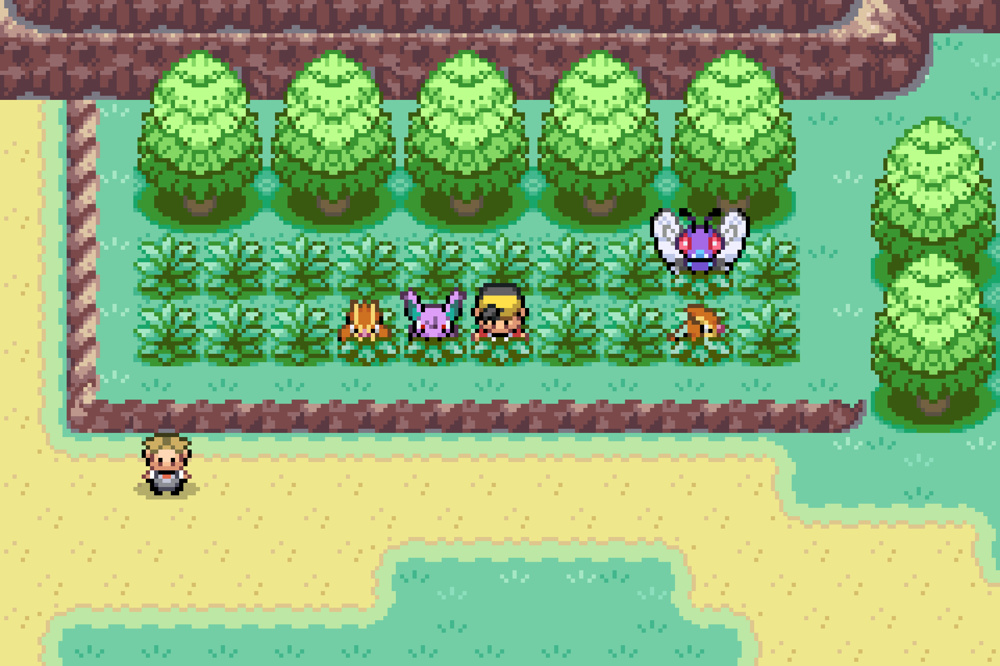
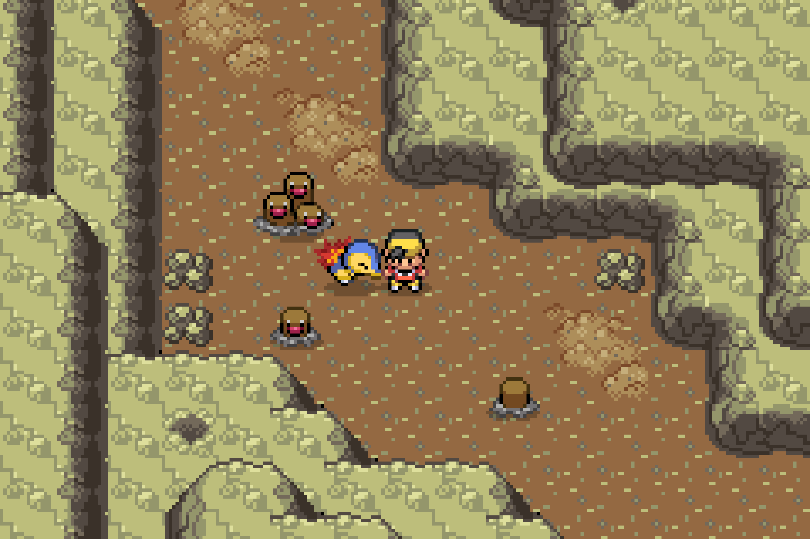
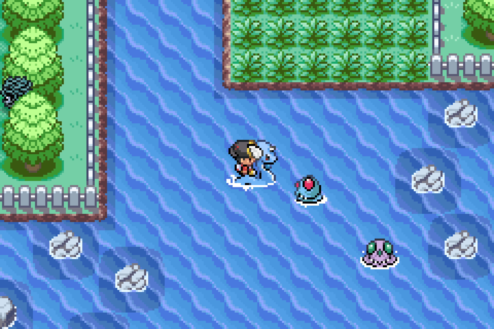
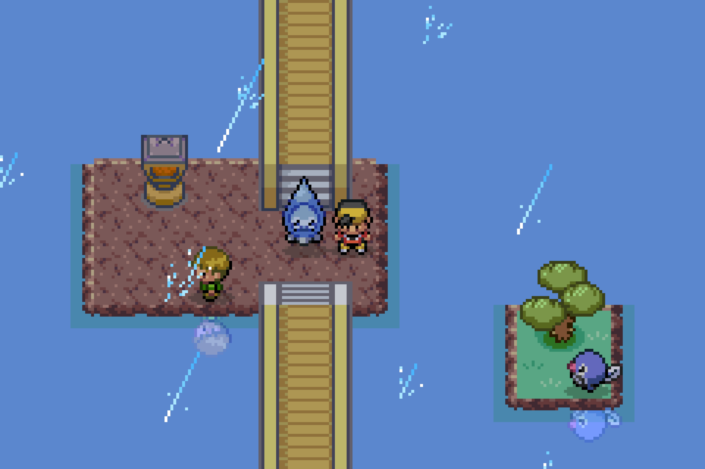
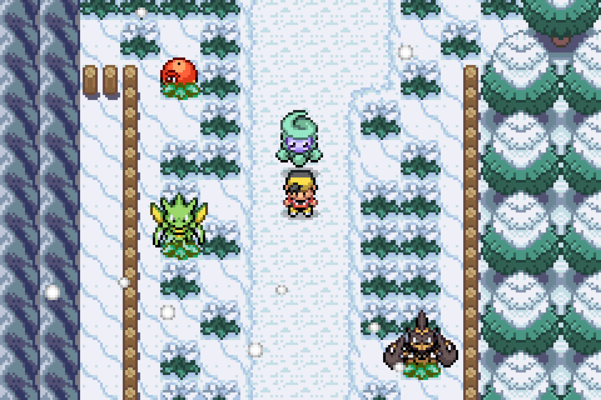
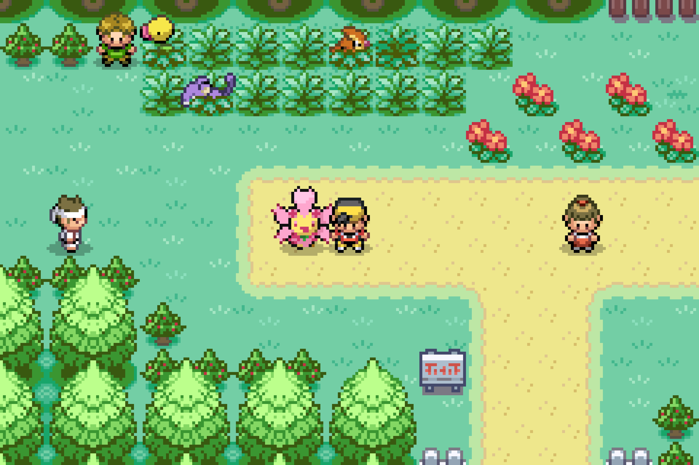

# Pokémon Heart And Soul 2.0.6 - Overworld Encounters + Dynamic Weather 

A fork of Pokémon Heart And Soul 2.0.6 featuring visible overworld Pokémon encounters in grass, caves, and water, including shiny Pokémon. Dynamic weather now added. 

---

## 🎮 Download — v1.0.3

### **📥 [DOWNLOAD THE OVERWORLD ENCOUNTERS & DYNAMIC WEATHER BPS PATCH](https://github.com/T3chnoGandalf/Overworld-encounters-for-Heart-and-Soul-2.0.6/releases/tag/v1.0.3)**

**Version:** 1.0.3 
**Base game:** Pokémon HeartAndSoul 2.0.6  
**Format:** BPS patch

Download `heartandsoul-2.0.6-overworld.bps` from the release's **Assets** section.

> **Important:** This download is a patch, not a complete Pokémon ROM. You need a compatible copy of HeartAndSoul 2.0.6.

---

## ✨ Features

- 🌿 **Grass encounters** — Wild Pokémon spawn in tall grass.
- 🪨 **Cave encounters** — Wild Pokémon spawn in caves.
- 🌊 **Water encounters** — Wild Pokémon spawn in water.
- ⭐ **Shiny Pokémon** — Shiny Pokémon can appear as overworld encounters.
- 📊 **Original encounter tables** — Uses Heart And Soul's existing encounter tables.
- 🎣 **Fishing encounters** — Fishing encounters including in water overworld encounters.
- 🌧️ **Dynamic weather** — Weather changes automatically over time, bringing sun, rain and storms to the overworld.

---

## 📥 Installation

1. Obtain a compatible Pokémon Heart And Soul 2.0.6 ROM.
2. Download the `.bps` patch from the release page above.
3. Open a BPS-compatible patching tool.
4. Apply the patch to your compatible Heart And Soul 2.0.6 ROM.

### Heart And Soul Resources

- [HeartAndSoul on Hackdex](https://www.hackdex.app/hack/pokemon-heart-and-soul)
- [Original HeartAndSoul GitHub Repository](https://github.com/PokemonHnS-Development/pokemonHnS)

---

## 📸 Screenshots

<table>
   <tr>
    <th>🌿 Grass Encounters</th>
    <th>🪨 Cave Encounters</th>
    <th>🌊 Water Encounters</th>
  </tr>
  <tr>
    <td></td>
    <td></td>
    <td></td>
  </tr>
  <tr>
    <th>🌧️ Rainy Weather</th>
    <th>☀️ Sunny Weather</th>
    <th>❄️ Castform Snow Form</th>
  </tr>
  <tr>
    <td></td>
    <td></td>
    <td></td>
  </tr>
<tr>
  <th colspan="3">🌸 Cherrim Sunny Form</th>
</tr>
<tr>
  <td colspan="3" align="center">
    
  </td>
</tr>
</table>

---

## 💻 Source Code

The modified source code is available in this repository.

The main downloadable release is provided as a `.bps` patch.

---

## 🙏 Credits

- **Heart And Soul Development Team** — Original Heart And Soul project.
- **Pokémon Expansion Contributors** — Base engine, tools, and development resources.
- **T3chnoGandalf** — Overworld encounter modifications and public release.

---

## 📋 Release Information

**v1.0.0 — Initial Release**

Introduces visible wild Pokémon encounters in grass, caves, and water, including shiny overworld encounters.

**[View Releases & Download the Patch](https://github.com/T3chnoGandalf/Overworld-encounters-for-Heart-and-Soul-2.0.6/releases)**
